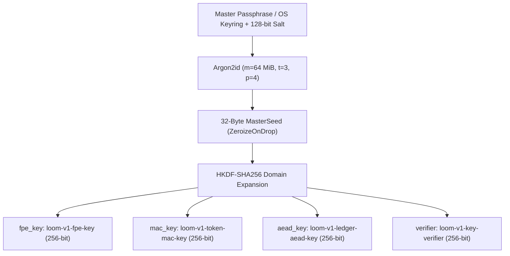

# Clave Architecture Specification

## 1. Threat Model & Design Goals

Engineers routinely need to share stack traces, configuration files, SQL dumps, or git diffs with cloud LLMs, external contractors, or public issue trackers. Existing sanitization tools fail in one of two ways:
1. **Destructive One-Way Redaction (`[REDACTED]`):** Breaks JSON/TOML/Rust syntax, collapses distinct IP addresses or UUIDs into identical placeholders, and prevents patches generated by an LLM from applying cleanly.
2. **Plaintext Mapping Files:** Naive pseudonymizers write a plaintext JSON/CSV lookup table to disk, creating a high-value credential leak vector.

**Clave** eliminates both failure modes through a hybrid **Stateless Bijective Feistel FPE + AEAD Blind-Indexed SQLite WAL Ledger**.

---

## 2. Cryptographic Key Hierarchy (`src/crypto/mod.rs`)

---

## 3. Bijective Format-Preserving Encryption (`src/crypto/fpe.rs`)

For fixed-width structured identifiers (`IPv4` subnets and 128-bit `UUID`s), Clave executes an **8-round balanced Feistel network** where the round function $F_k(r, R_i)$ is a keyed `BLAKE3` Pseudo-Random Function (PRF):

$$L_{i+1} = R_i, \quad R_{i+1} = L_i \oplus \text{BLAKE3}_{k_{\text{fpe}}}(\text{domain} \parallel i \parallel R_i)$$

- **IPv4 Private Subnet Bijection (`192.168.0.0/16` <-> `10.244.0.0/16`):** The 16-bit host suffix (`X.Y`) of any `192.168.X.Y` address is permuted via `feistel16_encrypt` into `10.244.A.B`. Because the Feistel network is a strict mathematical bijection, two distinct `192.168.x.x` addresses can never collide, and `fpe_decrypt_ipv4_192_168` can invert `10.244.A.B` back to `192.168.X.Y` **statelessly** using only `fpe_key`.
- **128-Bit UUID Bijection:** Splits a 128-bit UUID into upper and lower 64-bit halves and applies `feistel64_encrypt` with distinct domain tags (`loom-uuid-hi`, `loom-uuid-lo`), preserving canonical `8-4-4-4-12` hyphenated syntax.

---

## 4. Blind-Indexed AEAD Token Ledger (`src/store/mod.rs`)

For variable-length identifiers (`CustomDict`, `ApiKey`, `Jwt`, `Email`, `UserPath`), Clave stores bidirectional mappings in a local SQLite WAL database (`loom.db`) under strict owner-only ACLs:
- **Blind Indexing (`real_mac` & `synthetic_mac`):** Lookups compute $\text{BLAKE3}_{k_{\text{mac}}}(\text{category} \parallel \text{value})$. No plaintext or unkeyed hash is ever written to SQLite indexes.
- **Row-Bound Envelope Encryption (`XChaCha20-Poly1305`):** Both `real_ciphertext` and `synthetic_ciphertext` are encrypted with fresh 192-bit CSPRNG nonces and Additional Authenticated Data (`loom-v1|{row_uuid}|{category}|{field}`), preventing cross-row or cross-column ciphertext swapping.

---

## 5. Non-Overlapping Span Resolution & SIMD Restoration (`src/detector/` & `src/engine/`)

1. **Detection (`weave`):** Combines a SIMD `Aho-Corasick` (`LeftmostLongest`) automaton for custom dictionary terms with zero-backtracking `regex` DFA recognizers across 7 entity classes. Overlapping spans are resolved deterministically by earliest start offset, longest match span, and category priority (`Email` `operator@192.0.2.10` supersedes nested `IPv4` `192.0.2.10`).
2. **Restoration (`unweave`):** Builds an in-memory `Aho-Corasick` (`LeftmostLongest`) automaton over all synthetic tokens in the ledger, followed by a stateless Feistel FPE pass over any remaining `10.244.A.B` IPv4 tokens.
