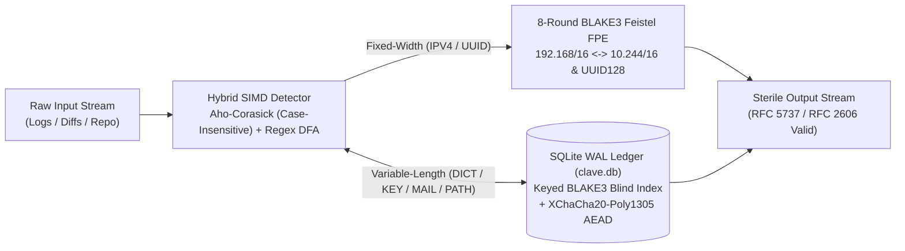

# Clave - A highly-competent cleaner for your repo. Think 'Mr. Wolf' from Pulp Fiction...

[](https://github.com/tsiscoe/Clave/actions/workflows/ci.yml)
[](LICENSE)
[](Cargo.toml)
[![Safety: #![forbid(unsafe_code)]](https://img.shields.io/badge/unsafe-forbid-success.svg)](src/lib.rs)

**Clave** — from operating-room shorthand for an **autoclave** (high-pressure surgical sterilizer) fused with the Latin *clavis* (**cryptographic key**) — is a pure-Rust reversible scrubber and pre-publish sterility gate that cooks credentials, PII, and SII (system-identifying information like internal IPs, machine names, and local paths) out of your public-facing repositories, logs, and AI prompts without breaking parsers or builds.

---

## Why Does Clave Exist?

Because every day, millions of software engineers copy-paste production stack traces containing internal IPv4 subnets, database passwords, JWTs, and their own home directory paths directly into cloud LLM chat boxes, and then act surprised when their infrastructure gets owned. Sharing an un-scrubbed crash log with a frontier AI model is like handing a burglar a blueprint of your house and a note explaining which window doesn't latch.

And the traditional "solution" — running `sed 's/.../[REDACTED]/g'` — is completely useless:
- If you replace three different production servers (`192.0.2.10`, `192.0.2.20`, `192.0.2.30`) with the word `[REDACTED]`, the AI can't tell which server is talking to which, and its proposed fix won't even parse.
- Even worse, when the AI sends back a 400-line patch full of `[REDACTED]`, you have to spend your Friday night manually typing all your real coordinates back in like a medieval monk transcribing a ransom note.

Named after the surgical **autoclave** (which cooks every spore of biological host DNA off a scalpel with superheated steam while leaving the steel blade's tolerances intact) and the Latin *clavis* (**key**), **Clave** treats your workstation's SII, PII, and credentials like biological contamination that must be sterilized before crossing a public boundary—yet unlocked with your key on return:
1. **`clave weave` (Pseudonymize):** Deterministically transforms your private IPs, UUIDs, API keys, emails, OS user paths, and custom machine names into **syntactically valid RFC 5737 / RFC 2606 equivalents** (`192.0.2.10:8080` -> `10.244.183.91:8080`, `operator@example.com` -> `id_7f9a2c1b@example.com`, `C:\Users\user_demo\app` -> `C:\Users\user_4c8e19a2\app`). Every parser, IP validator, and compiler stays happy.
2. **`clave unweave` (Restore):** When the AI hands back a fixed config or git patch using those synthetic tokens, Clave runs a SIMD `Aho-Corasick` (`LeftmostLongest`) pass and inverts its 8-round `BLAKE3` Feistel network to put your real IPs, UUIDs, and hostnames right back where they belong in milliseconds.
3. **`clave audit` (CI & Pre-Publish Sterility Gate):** Scans your git repository before you make it public (respecting `.gitignore` and capping files at `16 MiB`) and screams at you if you accidentally left your real username, internal IP, or secret codename inside a code comment. (During development, when we enabled case-insensitive dictionary matching in `[SEC-02]`, `clave audit` immediately flagged `src/store/mod.rs` for containing one of our own machine names inside the doc-comment explaining how case-insensitive dictionary matching works. The tool snitched on its own birth certificate.)



---

## Cryptographic & Security Architecture (`#![forbid(unsafe_code)]`)

Most "privacy scrubbers" write a plaintext JSON lookup table to `/tmp` and pray nobody looks in it. We built **Clave** like the disk is already hostile:

| Layer | Primitive | What It Actually Does |
| :--- | :--- | :--- |
| **Memory & Type Safety** | `#![forbid(unsafe_code)]` + `ZeroizeOnDrop` | Zero `unsafe` blocks in the entire crate; all key material, CLI passphrases, and decrypted buffers are wiped on drop (`[SEC-01]`). |
| **Master Key Derivation** | `Argon2id` (`m=64 MiB, t=3, p=4`) + `HKDF-SHA256` | Turns your passphrase (or OS Keyring secret via `--keyring`) into four domain-separated 256-bit subkeys (`clave-v1-fpe-key`, `clave-v1-token-mac-key`, `clave-v1-ledger-aead-key`, `clave-v1-key-verifier`) checked in constant time (`constant_time_eq_32`). |
| **Stateless FPE Bijection** | 8-Round Balanced Feistel Network (`BLAKE3` PRF) | Permutes 16-bit IPv4 host suffixes (`192.168.0.0/16` <-> `10.244.0.0/16`), 32-bit, 64-bit, and 128-bit (`UUIDv4`) domains with zero database state required for inversion. |
| **Blind-Indexed SQLite Vault** | `XChaCha20-Poly1305` (192-bit nonce) + Keyed `BLAKE3` MACs | Variable-length secrets (`KEY`, `JWT`, `MAIL`, `PATH`, `DICT`) are indexed by keyed `BLAKE3` MACs and encrypted with row-bound AAD (`clave-v1\|id\|category\|field`) and `PRAGMA secure_delete = ON` inside `clave.db`. |
| **Case-Insensitive `[DICT]`** | SIMD `Aho-Corasick` (`LeftmostLongest`, `.ascii_case_insensitive(true)`) | Catches lowercase, uppercase, and mixed-case variants of registered hostnames and codenames and resolves them to the same canonical alias (`[SEC-02]`). |
| **Filesystem ACLs & Atomic I/O** | `icacls /inheritance:r` (Win) / `0700` & `0600` (Unix) + `.clave_atomic_tmp` | Locks down the ledger directory and `.db` file to the current OS user and performs atomic write-then-rename operations during `weave --dir` (`[SEC-03]`). |
| **Terminal Sanitization** | `sanitize_terminal_str` (`CWE-150`) | Strips C0/C1 control characters and ANSI/OSC escape sequences before rendering untrusted logs in `clave tui`. |

---

## How to Use It Without Embarrassing Yourself

### 1. Build & Install from Source

```bash
git clone https://github.com/tsiscoe/Clave.git
cd Clave
cargo install --path .
```

### 2. Register Custom Hostnames or Codenames (`clave dict`)

```bash
# Store master passphrase in OS native credential manager (--keyring) or CLAVE_PASSPHRASE
clave --keyring dict add --term "BastionProdNode" --alias "node_alpha_01"
clave --keyring dict list
```

### 3. Pipe Logs or Diffs Through `clave weave` & `clave unweave`

```bash
# Scrub a sensitive log or git diff before sending it to an LLM
git diff | clave --keyring weave > sterile.patch

# Restore the LLM's patched output back to your real local IPs, paths, and hostnames
clave --keyring unweave -i llm_response.patch -o restored.patch
```

### 4. Audit or Sterilize a Repository (`clave audit` / `clave weave --dir`)

> **Tip:** Standard credentials, IPs, UUIDs, emails, and OS user paths are detected automatically. Register custom machine names or project codenames once with `clave --keyring dict add --term "<name>"` before running `clave audit` so bespoke SII is caught too.

```bash
# Scan a repository and fail CI if any PII, internal IP, user path, or key is found
clave --keyring audit ./my-repo --fail-on-leak

# Recursively scrub all UTF-8 files in a directory in-place
clave --keyring weave --dir ./my-repo
```

### 5. Interactive Ratatui Side-by-Side Diff Viewer (`clave tui`)

```bash
clave --keyring tui --file crash.log
```

---

## Verification & Property-Based Test Suite

```bash
cargo test
cargo clippy --all-targets -- -D warnings
```

---

## License

Licensed under the [MIT License](LICENSE). Use it in good health, or at least use it before you paste your production credentials into a public pull request.
